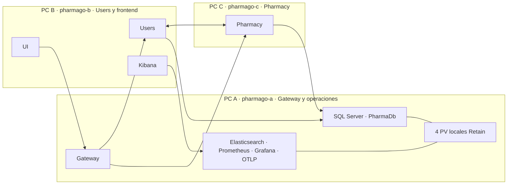

# Topología Kubernetes de PharmaGo

PharmaGo tiene dos entornos documentados: k3s en tres PCs físicas conectadas por Tailscale y laboratorios Minikube sobre una PC. La distribución de servicios por etiquetas es común; la ubicación física y las pruebas acreditadas dependen de cada entorno. [Despliegue físico](aiops-k3s-tailscale.md) · [Despliegue y gestión de manifiestos](<../Implementacion K8S/Codigo/k8s/README-k8s.md>) · [Matriz de requisitos](aiops-requirements-matrix.md)

El modo predeterminado usa un selector obligatorio `pharmago.io/service` distinto por servicio. Un nodo solo puede tener un valor para esa etiqueta, así que Gateway, Users y Pharmacy no comparten un nodo Kubernetes. Desde la #7, Users y Pharmacy tienen dos réplicas y Gateway tiene una. Cada Deployment permite un pod adicional en el mismo grupo durante el rollout (`maxSurge: 1`, `maxUnavailable: 0`). Una anti-afinidad obligatoria entre pods del mismo servicio impediría ese solapamiento en la topología mínima. [Probes y réplicas](aiops-k8s-probes.md) · [Selectores de Kubernetes](https://kubernetes.io/docs/concepts/scheduling-eviction/assign-pod-node/#nodeselector) · [RollingUpdate](https://kubernetes.io/docs/concepts/workloads/controllers/deployment/#rolling-update-deployment)

Fluent Bit, Node Exporter y kubelet-storage ejecutan un pod por nodo como DaemonSets. UI y Kibana comparten la etiqueta `node-type=frontend`; el nodo `ops` guarda SQL, Elasticsearch, Prometheus y Grafana junto con Gateway, Jaeger y Collector. La UI y la observabilidad no son los microservicios sujetos a separación en este diseño.

## Nodos Kubernetes y hosts físicos

| Pods de servicio | Nodo k3s | PC física | RAM física / visible para Kubernetes |
|---|---|---|---|
| Gateway | `pharmago-a` (server) | A | 16 GB / aproximadamente 7,76 GiB |
| Users ×2 | `pharmago-b` (agent) | B | 16 GB / aproximadamente 5,79 GiB |
| Pharmacy ×2 | `pharmago-c` (agent) | C | 8 GB / aproximadamente 2,84 GiB |

La [evidencia física](evidence/chaos-3pc-20261116/README.md) registra una PC por integrante, k3s en Ubuntu/WSL2 y Tailscale. El [inventario de nodos](evidence/chaos-3pc-20261116/nodes.json) informa la memoria visible para Kubernetes; no equivale a toda la RAM instalada en Windows. El [inventario de pods](evidence/chaos-3pc-20261116/pods.txt) permite contrastar la asignación y el [diagrama](evidence/chaos-3pc-20261116/topologia-3pc.png) representa ese despliegue.

Los laboratorios anteriores usaron `pharmago-issue3`, `pharmago-issue3-m02` y `pharmago-issue3-m03` sobre una PC, y `pharmago-issue17-validation` con un nodo y Calico. Esas evidencias acreditan separación lógica o desarrollo local. No se trasladan automáticamente al entorno físico las pruebas de rollout, recuperación SQL o validación completa de telemetría.

Las dos réplicas de Users y Pharmacy comparten su PC; no toleran perder ese host. PC A concentra servidor k3s, SQL, Gateway y observabilidad: su conectividad y sus volúmenes locales son puntos únicos de falla. El scheduler conoce nodos y no verifica por sí solo la identidad del hardware.

## Recursos de aplicación y capacidad

Cada pod de Gateway, Users o Pharmacy pide **100m CPU / 128 MiB** y tiene límites de **500m / 384 MiB**. Durante el surge, Gateway necesita **200m / 256 MiB** en requests y puede consumir hasta **1000m / 768 MiB**. Users y Pharmacy necesitan cada uno **300m / 384 MiB** y tienen límites de **1500m / 1152 MiB** para sus tres pods. Tener otro nodo elegible por servicio requiere capacidad, imágenes y una política de colocación que lo permita. El Job de la #5 ejecuta las migraciones antes del rollout. [Migraciones](aiops-sql-migrations.md)

### Referencia de dimensionamiento del laboratorio Minikube

Suma por nodo de la topología de tres nodos en el ensayo de la #3. Incluye los Deployments asignados y los dos DaemonSets de ese ensayo. El pico modela el rollout simultáneo de los tres servicios. Para el presupuesto actual, sumar por nodo `50m / 64 MiB` en requests y `200m / 128 MiB` en límites para `kubelet-storage` (#6). Sumar además `100m / 128 MiB` en requests y `500m / 384 MiB` en límites en los nodos B y C por la segunda réplica (#7). [Métricas de Kubernetes](aiops-k8s-metrics.md)

| Nodo | Requests estable (CPU / MiB) | Requests con surge (CPU / MiB) | Límites con surge (CPU* / MiB) | Límite Docker local (CPU / MiB) | Punto de partida académico (CPU / RAM / disco libre) |
|---|---:|---:|---:|---:|---:|
| A — Gateway, almacenamiento y OTLP | 1450m / 2468 | 1550m / 2596 | 3450m / 5576 | 4 / 4200 | 6 / 8 GiB / 55 GiB |
| B — Users, UI, Kibana | 600m / 1508 | 700m / 1636 | 1700m / 3528 | 2 / 2100 | 4 / 5 GiB / 15 GiB |
| C — Pharmacy | 300m / 356 | 400m / 484 | 1000m / 1224 | 2 / 1100 | 2 / 2 GiB / 10 GiB |

\* CPU suma los límites definidos: Fluent Bit y Node Exporter no tienen límite de CPU. Los números no incluyen kubelet, control plane, CNI ni servicios ajenos; verificar el espacio libre efectivo por nodo y reservar margen para el sistema y pods terminando. El límite Docker local no cubre todos los máximos de los contenedores a la vez. Minikube con este driver reporta en `allocatable` CPU y RAM de la VM de Docker; la columna local usa los topes reales de cada contenedor. El ensayo comprueba el escenario de rollout, sin garantía de carga máxima.

Los PV declaran 35 GiB en conjunto: SQL 10 GiB, Elasticsearch 10 GiB, Prometheus 10 GiB y Grafana 5 GiB. `hostPath` no reserva ni impone esas cuotas. El presupuesto académico reserva espacio adicional para imágenes, logs y sistema; medir el disco real en el nodo y en el volumen de Docker. No mover `node-type=ops` a otro nodo: los directorios no se mueven. Ver la [guía de datos y recuperación](aiops-k8s-recovery.md).

El modo de un solo nodo sigue disponible para desarrollo explícito. SQL, Elasticsearch, Prometheus y Kibana mantienen su estrategia existente. Esta prueba de capacidad y colocación no valida tolerancia a fallas (#7) ni continuidad con tráfico y versiones distintas (#8).

La colocación se aplica al programar un pod. Cambiar la etiqueta de un nodo no desalojará pods ya programados. Validar la topología en un perfil nuevo, o planificar la transición del clúster anterior y volver a comprobar la ubicación después de completar los rollouts.

El [ensayo del 09/11/2026](evidence/issue-3-20261109/README.md) confirmó las asignaciones y el pod adicional de los tres servicios con el stack completo.
