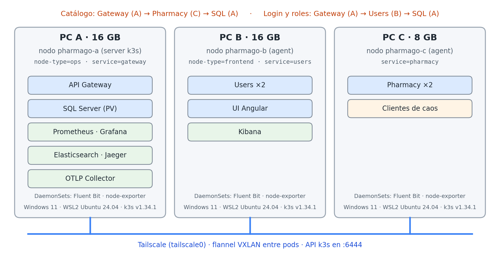

# Informe final del obligatorio AIOps

## PharmaGo

**Integrantes:** Joaquín Decia · 289568; Vicente Lavega · 319108; Damián Rodríguez · 308012
**Docente:** Juan Irabedra
**Corte:** 16 de noviembre de 2026 · `bb89cdc5e369c236465ea62be7167ff7f7d96943`

Extendimos PharmaGo, una aplicación .NET y Angular, con recuperación, despliegues seguros, telemetría, detección de anomalías y experimentos de caos. Desplegamos Gateway, Users y Pharmacy en tres PCs físicas y aprobamos seis categorías de caos, conservando un intento de red fallido. Las pruebas locales registran recuperación de procesos, 226 solicitudes válidas durante rollout y rollback, cinco alertas verificadas y almacenamiento con I/O sostenida. Cada resultado conserva el alcance de su entorno.

El informe sigue los ocho elementos de la rúbrica y presenta desafíos, decisiones y resultados medidos. El corte documental bb89cdc incorpora las evidencias físicas y la matriz actualizada; las corridas en tres PCs registran código ae24ebe. Las pruebas conservan sus propios commits, imágenes y entornos; reunirlas aquí no constituye una nueva ejecución integral.

## 1 Implementación de plataforma

Desplegamos la interfaz Angular, API Gateway, Users y Pharmacy en pods independientes, con Services para el descubrimiento interno. En tres PCs físicas, Gateway ocupa pharmago-a, Users pharmago-b y Pharmacy pharmago-c. Users y Pharmacy tienen dos réplicas por servicio; Gateway, una. El catálogo recorre Gateway → Pharmacy → SQL; roles y login recorren Gateway → Users → SQL. [E14](https://github.com/damyyyrr/Obligatorio-AIOps-289568-319108-308012/blob/bb89cdc5e369c236465ea62be7167ff7f7d96943/docs/evidence/chaos-3pc-20261116/README.md)

Cada integrante aportó una PC: A y B con 16 GB físicos, C con 8 GB. Los nodos usan k3s v1.34.1+k3s1 en Ubuntu/WSL2. Tailscale conecta las interfaces tailscale0 y transporta flannel VXLAN. A concentra Gateway, SQL, Elasticsearch, Prometheus, Grafana, Jaeger y Collector; B aloja Users, UI y Kibana; C, Pharmacy y clientes de caos. Fluent Bit, node-exporter y kubelet-storage corren en los tres nodos. Inventarios y reportes documentan esta separación física. [E14](https://github.com/damyyyrr/Obligatorio-AIOps-289568-319108-308012/blob/bb89cdc5e369c236465ea62be7167ff7f7d96943/docs/evidence/chaos-3pc-20261116/README.md)

En Minikube se probaron aplicación idempotente de manifiestos, migraciones mediante Job, arranque, segundo apply y parada/reanudación. SQL, Elasticsearch, Prometheus y Grafana usan PV/PVC; se probó reemplazo del pod SQL y restauración en otro volumen conservando registros. hostPath depende del host y sus cuotas no reservan espacio físico. Estas pruebas locales no se presentan como repetidas en las tres PCs. [E2](https://github.com/damyyyrr/Obligatorio-AIOps-289568-319108-308012/blob/bb89cdc5e369c236465ea62be7167ff7f7d96943/docs/aiops-k8s-topology.md)

El principal desafío entre PCs fue la red: el intento con Hamachi permitió conectar los nodos, pero no el tráfico VXLAN entre pods. La migración a Tailscale dentro de Ubuntu permitió DNS y comunicación entre servicios. Los scripts publicados conservan esa preparación y migración, no una instalación completa desde cero. PC A y su enlace siguen siendo un punto único de falla. Los perfiles Minikube anteriores se conservan como laboratorios locales. [E14](https://github.com/damyyyrr/Obligatorio-AIOps-289568-319108-308012/blob/bb89cdc5e369c236465ea62be7167ff7f7d96943/docs/evidence/chaos-3pc-20261116/README.md)

## 2 Alta disponibilidad

Separamos salud de proceso y disponibilidad funcional. Liveness detecta un proceso sin respuesta y permite reiniciarlo; readiness decide si un pod debe recibir tráfico. Users y Pharmacy verifican su acceso a SQL. Ante dependencias aisladas se observaron respuestas 503 y NotReady, manteniendo liveness en 200 y sin reinicios innecesarios. Gateway admite un estado Degraded después de establecer contacto inicial con sus upstreams, para conservar una respuesta acotada al cliente. [E3](https://github.com/damyyyrr/Obligatorio-AIOps-289568-319108-308012/blob/bb89cdc5e369c236465ea62be7167ff7f7d96943/docs/evidence/issue-7-20261110/README.md)

### Recuperación observada

El 10/11 se suspendió con SIGSTOP un proceso dotnet por vez. Kubernetes observó Ready → NotReady → Ready, reinició el contenedor y Prometheus registró up en 1 → 0 → 1. Los tiempos se midieron desde la suspensión hasta Ready; no se presentan como MTTR humano. [E3](https://github.com/damyyyrr/Obligatorio-AIOps-289568-319108-308012/blob/bb89cdc5e369c236465ea62be7167ff7f7d96943/docs/evidence/issue-7-20261110/README.md)

| Proceso | Hasta Ready | HTTP 200 válidos | Sin respuesta HTTP |
| --- | --- | --- | --- |
| Gateway | 40,57 s | 2 de 21 | 19 |
| Users | 37,77 s | 7 de 8 | 1 |
| Pharmacy | 34,95 s | 18 de 19 | 1 |

Los conteos incluyen antes, durante y después de cada falla. Se recuperó la dotación de 1 Gateway, 2 Users y 2 Pharmacy. El resultado demuestra autocuración de procesos, con interrupciones observadas y recuperación de aproximadamente 35 a 41 s; no alcanza el objetivo ideal de pocos segundos en todos los casos. [E3](https://github.com/damyyyrr/Obligatorio-AIOps-289568-319108-308012/blob/bb89cdc5e369c236465ea62be7167ff7f7d96943/docs/evidence/issue-7-20261110/README.md)

### Contención de solicitudes fallidas

El Gateway aplica límites por instancia y devuelve 429 con Retry-After. Se normalizaron rutas y se corrigieron bypass y una carrera en el contador. Con dos pods la cuota agregada aumenta: se midieron 200 respuestas aceptadas de 300 frente a 100 con uno. Por ello conservamos una réplica de Gateway; escalar exige revisar la política de cuota. [E4](https://github.com/damyyyrr/Obligatorio-AIOps-289568-319108-308012/blob/bb89cdc5e369c236465ea62be7167ff7f7d96943/docs/evidence/issue-9-20261111/README.md)

Los timeouts limitan el trabajo pendiente: conexión SQL de 5 s, comando de 8 s, conexión a upstream de 2 s y presupuesto del Gateway de 10 s. En el ensayo de SQL caída, la espera máxima pasó de 120 s, limitada por el cliente, a unos 10 s, y las solicitudes en vuelo de 205 a 28. Se conservaron los errores observados, sin reintentos automáticos de la plataforma. [E4](https://github.com/damyyyrr/Obligatorio-AIOps-289568-319108-308012/blob/bb89cdc5e369c236465ea62be7167ff7f7d96943/docs/evidence/issue-9-20261111/README.md)

La recuperación de un proceso no garantiza tolerancia a la pérdida del host: las réplicas comparten su nodo elegible, SQL tiene una instancia y Gateway constituye un punto de interrupción posible. Los datos de esta sección no acreditan disponibilidad global del 100 %.

## 3 Despliegues seguros

Elegimos RollingUpdate para Gateway, Users y Pharmacy. maxUnavailable=0 conserva la dotación disponible durante el reemplazo y maxSurge=1 permite crear un pod adicional. El pod nuevo debe superar readiness y permanecer Ready durante 10 s. Esta política requiere capacidad para versiones coexistentes y operaciones compatibles con el mismo esquema de datos. [E5](https://github.com/damyyyrr/Obligatorio-AIOps-289568-319108-308012/blob/bb89cdc5e369c236465ea62be7167ff7f7d96943/docs/evidence/issue-8-20261111/README.md)

| Mecanismo | Propósito y condición |
| --- | --- |
| Readiness y minReadySeconds | Retirar un pod anterior solo después de observar el nuevo disponible durante 10 s. |
| preStop de 10 s | Dar tiempo a propagar la retirada de endpoints manteniendo el servidor en servicio. |
| Apagado de 20 s y gracia de 40 s | Completar solicitudes en vuelo y reservar margen para el hook y el apagado. |
| Migraciones previas y rollback | Ejecutar el Job de migración antes del rollout y conservar revisiones compatibles; no ejecutar migraciones Down. |

### Resultado del reemplazo y la reversión

El 11/11 se actualizaron y revirtieron los tres servicios con tráfico por el Service normal de Gateway. Durante 282,139 s se obtuvieron 226/226 solicitudes funcionalmente válidas: 95 consultas de catálogo, 95 de roles y 36 logins. El generador no reintentó ni descartó errores y mantuvo tráfico bajo las cuotas. Se observaron versiones Ready coexistentes y se conservaron las huellas de datos, diez migraciones y los UIDs de PV/PVC. [E5](https://github.com/damyyyrr/Obligatorio-AIOps-289568-319108-308012/blob/bb89cdc5e369c236465ea62be7167ff7f7d96943/docs/evidence/issue-8-20261111/README.md)

El ensayo usó una versión A ya preparada con la política de drenaje y una B compatible. El primer despliegue desde manifiestos anteriores y las migraciones futuras con cambios incompatibles quedan fuera de esa medición. Un timeout de progreso requiere diagnóstico: Kubernetes no convierte automáticamente ese timeout en un rollback.

### Alcance de la disponibilidad

El 100 % corresponde a las 226 solicitudes muestreadas durante ese recambio planificado local. No es un SLA continuo ni evidencia de reemplazo sin interrupción de todos los componentes. El equipo decidió limitar el recambio a Gateway, Users y Pharmacy, manteniendo SQL, frontend y observabilidad estables. SQL conserva una réplica y estrategia Recreate. [E5](https://github.com/damyyyrr/Obligatorio-AIOps-289568-319108-308012/blob/bb89cdc5e369c236465ea62be7167ff7f7d96943/docs/evidence/issue-8-20261111/README.md) El ensayo no se repitió en las tres PCs; los resultados de caos no sustituyen esa comprobación.

Frontend y stack de observabilidad tampoco forman parte de las 226 solicitudes de reemplazo. El desafío principal fue coordinar readiness, retiro de endpoints y solicitudes activas: tener dos pods declarados no basta si se termina el anterior antes de drenar su tráfico. La evidencia vincula la técnica con el comportamiento observado sin extender el resultado a la pérdida de un nodo físico.

## 4 Telemetría

Instrumentamos los servicios .NET con OpenTelemetry. Las métricas de aplicación viajan por OTLP al Collector y se exponen para Prometheus; Grafana permite analizarlas por servicio. cAdvisor, node-exporter y kube-state-metrics agregan consumo de contenedor/pod y estado de Kubernetes. Las validaciones detalladas de esta sección corresponden al laboratorio local. [E6](https://github.com/damyyyrr/Obligatorio-AIOps-289568-319108-308012/blob/bb89cdc5e369c236465ea62be7167ff7f7d96943/docs/evidence/issue-6-20261110/README.md) El stack también se desplegó en tres PCs, con agentes por nodo; no se declara repetida toda la validación de telemetría entre equipos. [E14](https://github.com/damyyyrr/Obligatorio-AIOps-289568-319108-308012/blob/bb89cdc5e369c236465ea62be7167ff7f7d96943/docs/evidence/chaos-3pc-20261116/README.md)

Las trazas se exportan mediante el Collector a Jaeger. Se consultaron por trace ID operaciones 200 con cadena Gateway servidor → cliente HTTP → Users o Pharmacy → cliente SQL, conservando contexto W3C. Un fallo SQL acotado produjo 500 en 5,224 s y spans de error consultables. No se presupone un span SQL cuando la conexión no llegó a establecerse. [E6](https://github.com/damyyyrr/Obligatorio-AIOps-289568-319108-308012/blob/bb89cdc5e369c236465ea62be7167ff7f7d96943/docs/evidence/issue-6-20261110/README.md)

Los logs estructurados JSON se recolectan con Fluent Bit y se consultan en Elasticsearch/Kibana. Se comprobaron correlaciones por trace ID y correlation ID y la permanencia de siete documentos seleccionados después de reemplazar Elasticsearch. Las muestras publicadas se sanitizaron; esta comprobación no equivale a una auditoría de todos los eventos históricos. [E6](https://github.com/damyyyrr/Obligatorio-AIOps-289568-319108-308012/blob/bb89cdc5e369c236465ea62be7167ff7f7d96943/docs/evidence/issue-6-20261110/README.md)

### Cinco alertas verificadas

| Señal | Condición | Permanencia |
| --- | --- | --- |
| Errores HTTP | 5xx >5 % y tráfico >0,1 req/s | 30 s |
| Latencia HTTP | p95 >1000 ms y tráfico >0,1 req/s | 30 s |
| CPU de pod | Uso >80 % del límite | 1 min |
| Memoria de pod | Working set >85 % del límite | 1 min |
| Running sin Ready | Condición Ready falsa en pod Running | 45 s |

Las cinco reglas efectivas coincidieron con los archivos versionados y se observaron transiciones individuales Firing → OK mediante ensayos reales, sin modificar umbrales. La evaluación ocurre cada 10 s; las permanencias y ventanas agregan demora a la detección. El p95 del histograma es una estimación por buckets, no una latencia máxima de cliente. [E7](https://github.com/damyyyrr/Obligatorio-AIOps-289568-319108-308012/blob/bb89cdc5e369c236465ea62be7167ff7f7d96943/docs/evidence/issue-13-20261112/README.md)

El desafío operativo fue correlacionar impacto y recursos: un pod Running puede no estar Ready, y up=1 solo prueba el scrape. Las sondas funcionales verifican contenido además del código HTTP. Jaeger conserva trazas en memoria y las pierde al reiniciar; la persistencia de Elasticsearch no acredita alta disponibilidad de todo el stack.

## 5 Técnicas de detección de anomalías

Implementamos Isolation Forest y One-Class SVM con núcleo RBF a partir del notebook docente disponible. Reproducimos exactamente su generación sintética de 300 ventanas de un minuto, con semilla 42 y 53 ventanas etiquetadas anómalas. Las variables son solicitudes/minuto, fracción de errores, latencia media en ms y CPU %. El insumo es checkout sintético, no telemetría recolectada de PharmaGo. El equipo adopta este dataset y protocolo para la entrega de ambos algoritmos. [E8](https://github.com/damyyyrr/Obligatorio-AIOps-289568-319108-308012/blob/bb89cdc5e369c236465ea62be7167ff7f7d96943/docs/evidence/issue-14-20261112/README.md)

### Protocolo reproducible

StandardScaler y ambos modelos se ajustan sobre las 300 ventanas, incluidas las contaminadas, conforme al práctico. kind e is_anomaly se reservan para evaluación posterior; no intervienen en el ajuste ni en la selección de parámetros. Isolation Forest usa 300 árboles, max_samples=min(256,n), contaminación 0,10 y semilla 42. One-Class SVM usa nu=0,10 y gamma=scale. Los scores aumentan con la rareza, pero sus escalas no son probabilidades ni comparables directamente entre modelos.

| Modelo | Precisión | Recall | F1 |
| --- | --- | --- | --- |
| Isolation Forest | 0,800000 | 0,452830 | 0,578313 |
| One-Class SVM RBF | 0,620690 | 0,339623 | 0,439024 |

| Modelo | TP | FP | FN | TN |
| --- | --- | --- | --- | --- |
| Isolation Forest | 24 | 6 | 29 | 241 |
| One-Class SVM RBF | 18 | 11 | 35 | 236 |

### Interpretación de los resultados

Isolation Forest obtuvo mayor F1 en esta muestra y detectó los ocho minutos de incidente 5xx, frente a cuatro de SVM. Sin embargo, omitió los 18 minutos de degradación y SVM detectó solo uno. Ambos alertaron actividad batch legítima, con cuatro y cinco falsos positivos de veinte minutos. El presupuesto cercano al 10 % difiere del 17,7 % etiquetado; no se ajustó para mejorar retrospectivamente el resultado. [E8](https://github.com/damyyyrr/Obligatorio-AIOps-289568-319108-308012/blob/bb89cdc5e369c236465ea62be7167ff7f7d96943/docs/evidence/issue-14-20261112/README.md)

Estas métricas son descriptivas sobre la misma muestra usada para entrenar, sin conjunto de prueba independiente. No acreditan generalización, MTTD ni superioridad en producción. La rareza estadística requiere contexto operacional y los modelos no incorporan una secuencia temporal como feature. Tampoco están conectados al circuito de alertas o mitigación automática de PharmaGo.

Se aprobaron 20 pruebas, dos ejecuciones CLI con salidas reproducidas y la ejecución completa del notebook, con siete celdas de código y tres figuras. CSV, scores, flags, matrices, errores y metadatos permiten inspeccionar cada predicción. La ampliación k-sigma/MAD del práctico queda fuera de estos dos algoritmos obligatorios. [E8](https://github.com/damyyyrr/Obligatorio-AIOps-289568-319108-308012/blob/bb89cdc5e369c236465ea62be7167ff7f7d96943/docs/evidence/issue-14-20261112/README.md)

## 6 Plan de contención de incidentes operacionales

El plan distingue preparación, detección, diagnóstico, contención, recuperación y revisión. Se registra un único entorno por intervención, con contexto/namespace, pod y UID, revisión, inventario de PV/PVC, hipótesis, acción inversa y condición de aborto. Running o una alerta en OK no sustituyen las comprobaciones de catálogo, roles, login y contenido esperado. [E9](https://github.com/damyyyrr/Obligatorio-AIOps-289568-319108-308012/blob/bb89cdc5e369c236465ea62be7167ff7f7d96943/docs/baseline-incidents.md)

| Rol previsto | Responsabilidad |
| --- | --- |
| Coordinación | Confirmar impacto y severidad; decidir cambios, aborto, escalamiento y cierre. |
| Respuesta técnica | Diagnosticar y ejecutar una acción reversible por vez sobre el destino identificado. |
| Observación y bitácora | Vigilar capacidad, tráfico y alertas; conservar tiempos y confirmar recuperación. |
| Enlace con interesados | Comunicar al equipo y escalar al propietario del host/datos o al docente según el alcance. |

S1 comprende riesgo para datos/host o presión de recursos y exige abortar. S2 corresponde a una operación crítica fallida con host estable; prevé actualización cada dos minutos y escalamiento si no mejora en cinco. S3 identifica pérdida de observabilidad y suspende nuevas inyecciones. Esas cadencias son objetivos del plan, no SLA medidos. Un 429 previsto en una cuota se analiza junto al tráfico legítimo afectado.

### Aplicación y aprendizaje

El 13/11 Joaquín Decia ejecutó seis casos guiados, observó Grafana, comprobó pods y endpoints y aportó bitácora y 37 capturas. Los seis finalizaron PASS y limpieza verified. Codex preparó helpers y guió el procedimiento; la inyección y reversión fueron automáticas. La revisión fue en solitario y no se atribuye una ejecución independiente a otro integrante. [E9](https://github.com/damyyyrr/Obligatorio-AIOps-289568-319108-308012/blob/bb89cdc5e369c236465ea62be7167ff7f7d96943/docs/baseline-incidents.md)

La experiencia llevó a explicitar variables por terminal, esperar Ready, identificar el pod por UID y conservar antes/subida/bajada. También se mantuvieron una consulta de desconexión mal rotulada y la anotación retrospectiva de RAM, interpretándolas por sus horas reales. Esa trazabilidad evita reemplazar un evento por una narración posterior más favorable.

Los reportes conservan tAck=null. La nota de CPU se escribió después del fin técnico y la de RAM retrospectivamente; no calculamos TTA, tiempo de detección humana ni un MTTR humano promedio. tRestore indica inicio observado de estabilidad y tVerified su comprobación posterior. La estabilidad muestreada no representa una garantía continua fuera de esa ventana.

Antes de la defensa corresponde acordar responsables y canal del equipo. La recuperación exige confirmar función, alertas, ausencia de nuevos reinicios y conservación de datos/configuración. Si no se verifica identidad, reversión o watchdog, no se inicia la carga; un cierre de terminal no reemplaza la recuperación documentada. [E9](https://github.com/damyyyrr/Obligatorio-AIOps-289568-319108-308012/blob/bb89cdc5e369c236465ea62be7167ff7f7d96943/docs/baseline-incidents.md)

## 7 Scripts de caos

El controlador implementa seis categorías y wrappers en modo plan por defecto. Exige contexto explícito, namespace de laboratorio, capacidad y baseline sano. Antes de mutar guarda un journal, toma un lock y confirma un watchdog independiente. Los agentes usan identidad, cancelación persistente y deadline para impedir arranques tardíos después de un aborto. Se conservan los ensayos locales y las corridas en tres PCs. [E10](https://github.com/damyyyrr/Obligatorio-AIOps-289568-319108-308012/blob/bb89cdc5e369c236465ea62be7167ff7f7d96943/docs/evidence/issue-17-20261112/fix-after-review/README.md) [E14](https://github.com/damyyyrr/Obligatorio-AIOps-289568-319108-308012/blob/bb89cdc5e369c236465ea62be7167ff7f7d96943/docs/evidence/chaos-3pc-20261116/README.md)

| Categoría | Estímulo y efecto registrado | Final |
| --- | --- | --- |
| Solicitudes | 240 solicitudes: 111 HTTP 200 y 129 HTTP 429; carga retirada y recuperación verificada. | PASS |
| CPU | Carga de 130 s en Pharmacy de PC C; restauración y estabilidad verificadas. | PASS |
| Memoria | Retención y liberación de 32 MiB en Pharmacy; sin demostrar OOM. | PASS |
| Almacenamiento | 26 pasadas sincronizadas observadas sobre 32 MiB; I/O sostenida observada y archivo eliminado. | PASS |
| Red | NetworkPolicy bloquea conexiones nuevas directas a Pharmacy; restauración comprobada. | PASS |
| Desconexión interna | Selector temporal del Service bloquea conexiones nuevas directas; luego se restituye. | PASS |

La tabla resume las seis categorías aprobadas en tres PCs. Hubo siete corridas: seis PASS y un intento de red FAIL, con cleanup=verified en todas. En red y desconexión fallaron las conexiones nuevas directas a Pharmacy; las sondas por Gateway respondieron 200 durante los cortes. Los reportes mantienen tAck=null: no miden reconocimiento humano. RAM no acredita OOM y storage registra deviceSaturation=null. [E14](https://github.com/damyyyrr/Obligatorio-AIOps-289568-319108-308012/blob/bb89cdc5e369c236465ea62be7167ff7f7d96943/docs/evidence/chaos-3pc-20261116/README.md)

### Fallos conservados y límites del almacenamiento

El primer intento de red restauró la NetworkPolicy, pero abortó durante la estabilidad posterior al perderse la evaluación sana de las alertas. Se conserva como FAIL; la repetición aprobó. El relato atribuye el episodio a Tailscale/Wi-Fi, pero el log citado no está publicado, por lo que esa atribución no queda verificada con ese archivo. La dependencia del enlace y de PC A limita la disponibilidad del conjunto. [E14](https://github.com/damyyyrr/Obligatorio-AIOps-289568-319108-308012/blob/bb89cdc5e369c236465ea62be7167ff7f7d96943/docs/evidence/chaos-3pc-20261116/README.md)

Como antecedente local del refuerzo de storage, un archivo de 32 MiB recibió 29 pasadas y 928 MiB lógicos. Hubo 61/61 sondas 200 válidas, 125,33 s estables y limpieza verificada. Tres arranques se bloquearon por memoria; el cuarto aprobó tras liberar caché WSL antes del baseline. CI exigió corregir una carrera del test de aborto. El ensayo registra árbol modificado y hashes, y acredita I/O sostenida, no saturación del dispositivo. [E11](https://github.com/damyyyrr/Obligatorio-AIOps-289568-319108-308012/blob/bb89cdc5e369c236465ea62be7167ff7f7d96943/docs/evidence/storage-io-20261114/README.md)

## 8 Defensa

La defensa está prevista para el 23/11/2026. El enunciado la define como un war-room a partir de un script de caos provisto por los docentes, donde el equipo aplica su plan y presenta hallazgos; la rúbrica también exige ejecutar el script propio y explicar los mecanismos implementados. La defensa aún no ocurrió y su mecánica específica será definida por el docente.

### Guion de demostración propuesto

1. Identificar versión, contexto, recursos y responsables; comprobar catálogo, roles, login, pods Ready, capacidad, targets y alertas antes de iniciar.

1. Revisar alcance e inversa del estímulo. Abrir telemetría del destino y registrar la primera señal real de impacto y su hora.

1. Contrastar respuesta funcional con métricas, trazas, logs, eventos y endpoints. Formular una hipótesis y elegir una acción reversible, conservando la bitácora.

1. Retirar el estímulo o aplicar la mitigación pertinente; comprobar recuperación estable, conservación de datos y limpieza. Explicar qué evidencia permite cerrar y qué sigue incierto.

Los ensayos realizados preparan al equipo para observar efectos y comprobar recuperación, pero no prueban la respuesta a un script docente desconocido. Cada integrante debe poder relacionar probes, réplicas, timeouts, drenaje y señales con el comportamiento que observe. La repetición guiada no se presenta como una defensa ya aprobada. [E9](https://github.com/damyyyrr/Obligatorio-AIOps-289568-319108-308012/blob/bb89cdc5e369c236465ea62be7167ff7f7d96943/docs/baseline-incidents.md)

### Validación complementaria y decisiones de alcance

BDD con Cypress y Cucumber aprobó cuatro escenarios reales en Electron headless: login válido, contraseña incorrecta y reintento, catálogo/detalle y 404 con regreso. browserExecuted=true y cero omisiones. La suite .NET del 14/11 aprobó 319/319 pruebas tras corregir solo el aislamiento de PurchasesDetailRepositoryTest. Estas validaciones complementan los ensayos, sin reemplazar disponibilidad ni defensa. [E12](https://github.com/damyyyrr/Obligatorio-AIOps-289568-319108-308012/blob/bb89cdc5e369c236465ea62be7167ff7f7d96943/docs/evidence/issue-15-20261112/live-after-fix/README.md)

| Punto | Estado al corte del informe |
| --- | --- |
| Separación física | Gateway, Users y Pharmacy distribuidos en tres PCs físicas con k3s/Tailscale; dos réplicas en una PC no toleran perderla. |
| Alcance de R03 | Recambio local de Gateway, Users y Pharmacy; SQL, frontend y observabilidad estables. Sin repetición del rollout en tres PCs. |
| Dataset y storage | El equipo adopta el dataset docente y los estímulos acotados actuales, con I/O sostenida observada sin afirmar saturación. |
| Equipo y entrega | El equipo mantiene tres integrantes según la sección principal de la letra; inscripción y entrega se verifican en Gestión. |

El PR 44 y sus checks se conservan como antecedente del incremento de almacenamiento. [E13](https://github.com/damyyyrr/Obligatorio-AIOps-289568-319108-308012/pull/44) El corte documental de este informe es bb89cdc; las corridas en tres PCs registran ae24ebe. La defensa y cualquier cambio posterior deben conservar su propia versión y evidencia. [E14](https://github.com/damyyyrr/Obligatorio-AIOps-289568-319108-308012/blob/bb89cdc5e369c236465ea62be7167ff7f7d96943/docs/evidence/chaos-3pc-20261116/README.md)

## 9 Reflexión ágil y uso de inteligencia artificial

El trabajo quedó dividido en issues enlazadas a requisitos, con ramas y PR hacia obligatorio y evidencias por incremento. Esto permitió distinguir implementación, validación y límites. Un ejemplo fue la prueba .NET por ID fijo: aislamos la base InMemory y consultamos el ID realmente insertado; la suite pasó a 319/319 sin cambiar producción. [E12](https://github.com/damyyyrr/Obligatorio-AIOps-289568-319108-308012/blob/bb89cdc5e369c236465ea62be7167ff7f7d96943/docs/evidence/issue-15-20261112/live-after-fix/README.md) Otro fue el refuerzo de storage: la revisión de la evidencia mostró que ocupar 32 MiB una vez era insuficiente para justificar carga sostenida y motivó una mejora del mismo caso. [E11](https://github.com/damyyyrr/Obligatorio-AIOps-289568-319108-308012/blob/bb89cdc5e369c236465ea62be7167ff7f7d96943/docs/evidence/storage-io-20261114/README.md)

Los checks y las ejecuciones reales aportaron información distinta. CI detectó una carrera del test que consultaba storage antes de la primera escritura; el laboratorio mostró límites de memoria y contención en Grafana. Registrar los intentos fallidos, corregir su causa y volver a verificar resultó más útil que declarar terminado un archivo. Los beneficios observados son trazabilidad y detección concreta de defectos; no contamos con mediciones para atribuir un ahorro de esfuerzo ni afirmar aplicación completa de Scrum. [E11](https://github.com/damyyyrr/Obligatorio-AIOps-289568-319108-308012/blob/bb89cdc5e369c236465ea62be7167ff7f7d96943/docs/evidence/storage-io-20261114/README.md)

### Declaración de uso de IA

Se utilizó Codex de OpenAI como asistente para analizar el repositorio y la letra, preparar y corregir código, pruebas, escenarios, configuración y documentación, interpretar resultados y redactar este informe. También asistió ejecuciones locales y la recopilación de evidencia. En los ensayos guiados, Joaquín Decia ejecutó comandos, observó Grafana y aportó capturas y notas; las inyecciones y reversiones fueron automatizadas por el controlador. La autoría del trabajo presentado y la responsabilidad por su contenido corresponden al equipo.

Se conservaron reportes originales, hashes, commits y límites de las mediciones para contrastar las afirmaciones generadas con IA. El equipo debe revisar el informe y comprender el código antes de entregar y defender; esta declaración no atribuye una revisión independiente a los tres integrantes ni confirma aprobaciones docentes que no están registradas.

### Fuentes y evidencias versionadas

Fuente académica: Obligatorio AIOps (3).docx provisto por el docente, guía del informe y rúbrica. Entrega indicada: 16/11/2026 a las 21:00 de Uruguay, máximo 10 páginas y archivo de hasta 40 MB. Los enlaces apuntan al corte documental bb89cdc; cada evidencia conserva su procedencia.

E1 · [Estado y matriz de requisitos](https://github.com/damyyyrr/Obligatorio-AIOps-289568-319108-308012/blob/bb89cdc5e369c236465ea62be7167ff7f7d96943/docs/aiops-requirements-matrix.md)

E2 · [Topología y recuperación de datos](https://github.com/damyyyrr/Obligatorio-AIOps-289568-319108-308012/blob/bb89cdc5e369c236465ea62be7167ff7f7d96943/docs/aiops-k8s-topology.md) · [Datos](https://github.com/damyyyrr/Obligatorio-AIOps-289568-319108-308012/blob/bb89cdc5e369c236465ea62be7167ff7f7d96943/docs/evidence/issue-4-20261109/README.md) · [Instalación](https://github.com/damyyyrr/Obligatorio-AIOps-289568-319108-308012/blob/bb89cdc5e369c236465ea62be7167ff7f7d96943/docs/evidence/issue-2-20261108/live/README.md)

E3 · [Recuperación de procesos](https://github.com/damyyyrr/Obligatorio-AIOps-289568-319108-308012/blob/bb89cdc5e369c236465ea62be7167ff7f7d96943/docs/evidence/issue-7-20261110/README.md)

E4 · [Rate limiting y timeouts](https://github.com/damyyyrr/Obligatorio-AIOps-289568-319108-308012/blob/bb89cdc5e369c236465ea62be7167ff7f7d96943/docs/evidence/issue-9-20261111/README.md) · [Timeouts](https://github.com/damyyyrr/Obligatorio-AIOps-289568-319108-308012/blob/bb89cdc5e369c236465ea62be7167ff7f7d96943/docs/evidence/issue-10-20261111/README.md)

E5 · [Rollout y rollback](https://github.com/damyyyrr/Obligatorio-AIOps-289568-319108-308012/blob/bb89cdc5e369c236465ea62be7167ff7f7d96943/docs/evidence/issue-8-20261111/README.md) · [Decisión sobre SQL](https://github.com/damyyyrr/Obligatorio-AIOps-289568-319108-308012/blob/bb89cdc5e369c236465ea62be7167ff7f7d96943/docs/supuesto-sql.md)

E6 · [Métricas trazas y logs](https://github.com/damyyyrr/Obligatorio-AIOps-289568-319108-308012/blob/bb89cdc5e369c236465ea62be7167ff7f7d96943/docs/evidence/issue-6-20261110/README.md) · [Trazas](https://github.com/damyyyrr/Obligatorio-AIOps-289568-319108-308012/blob/bb89cdc5e369c236465ea62be7167ff7f7d96943/docs/evidence/issue-11-20261112/README.md) · [Logs](https://github.com/damyyyrr/Obligatorio-AIOps-289568-319108-308012/blob/bb89cdc5e369c236465ea62be7167ff7f7d96943/docs/evidence/issue-12-20261112/README.md)

E7 · [Cinco alertas](https://github.com/damyyyrr/Obligatorio-AIOps-289568-319108-308012/blob/bb89cdc5e369c236465ea62be7167ff7f7d96943/docs/evidence/issue-13-20261112/README.md)

E8 · [Modelos y evaluación ML](https://github.com/damyyyrr/Obligatorio-AIOps-289568-319108-308012/blob/bb89cdc5e369c236465ea62be7167ff7f7d96943/docs/evidence/issue-14-20261112/README.md)

E9 · [Plan y aplicación guiada](https://github.com/damyyyrr/Obligatorio-AIOps-289568-319108-308012/blob/bb89cdc5e369c236465ea62be7167ff7f7d96943/docs/baseline-incidents.md) · [Seis casos y capturas](https://github.com/damyyyrr/Obligatorio-AIOps-289568-319108-308012/blob/bb89cdc5e369c236465ea62be7167ff7f7d96943/docs/evidence/issue-16-20261113/README.md)

E10 · [Ensayos técnicos de caos](https://github.com/damyyyrr/Obligatorio-AIOps-289568-319108-308012/blob/bb89cdc5e369c236465ea62be7167ff7f7d96943/docs/evidence/issue-17-20261112/fix-after-review/README.md)

E11 · [I/O sostenida y trazabilidad](https://github.com/damyyyrr/Obligatorio-AIOps-289568-319108-308012/blob/bb89cdc5e369c236465ea62be7167ff7f7d96943/docs/evidence/storage-io-20261114/README.md)

E12 · [BDD y suite .NET](https://github.com/damyyyrr/Obligatorio-AIOps-289568-319108-308012/blob/bb89cdc5e369c236465ea62be7167ff7f7d96943/docs/evidence/issue-15-20261112/live-after-fix/README.md) · [319 pruebas](https://github.com/damyyyrr/Obligatorio-AIOps-289568-319108-308012/blob/bb89cdc5e369c236465ea62be7167ff7f7d96943/docs/evidence/test-isolation-20261114/README.md)

E13 · [PR 44 integrado y CI aprobado](https://github.com/damyyyrr/Obligatorio-AIOps-289568-319108-308012/pull/44)

E14 · [Despliegue y caos en tres PCs](https://github.com/damyyyrr/Obligatorio-AIOps-289568-319108-308012/blob/bb89cdc5e369c236465ea62be7167ff7f7d96943/docs/evidence/chaos-3pc-20261116/README.md) · [Resumen de corridas](https://github.com/damyyyrr/Obligatorio-AIOps-289568-319108-308012/blob/bb89cdc5e369c236465ea62be7167ff7f7d96943/docs/evidence/chaos-3pc-20261116/summary.json)
