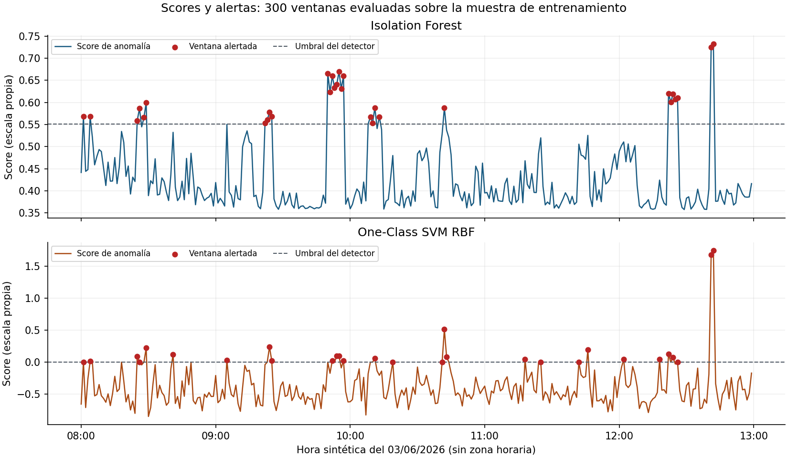
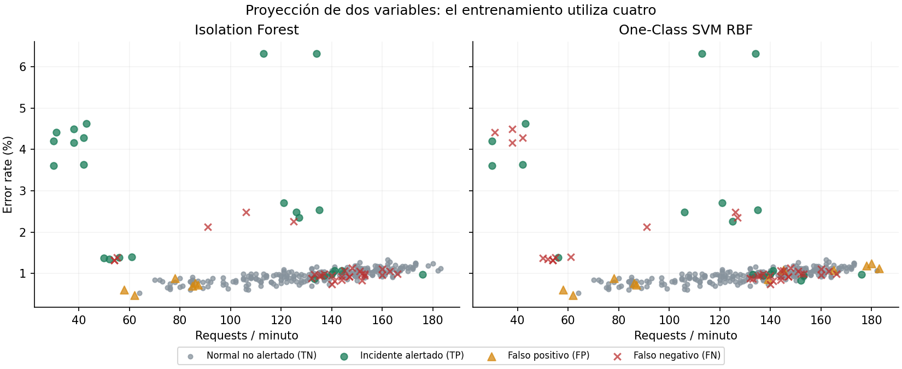
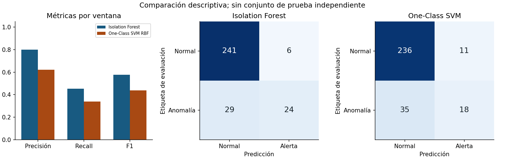

# Comparación de Isolation Forest y One-Class SVM RBF

Datos: 300 ventanas sintéticas del notebook docente, semilla 42; 53 ventanas etiquetadas como anómalas solo para evaluación. Fechas sintéticas, sin zona horaria. El dataset no proviene de PharmaGo ni de los ensayos Kubernetes.

El scaler y los dos modelos se ajustaron sobre las mismas 300 ventanas, incluidas las contaminadas, según el protocolo del práctico. Las cuatro features son requests, error_rate, latency_ms y cpu_pct. Las etiquetas kind/is_anomaly no entran al fit ni al escalado. No hubo selección de hiperparámetros con etiquetas ni cambio de umbral para mejorar F1.

## Resultados descriptivos sobre la muestra de entrenamiento

| model | windows | true_anomalies | alerts | tp | fp | fn | tn | precision | recall | f1 |
| --- | --- | --- | --- | --- | --- | --- | --- | --- | --- | --- |
| Isolation Forest | 300 | 53 | 30 | 24 | 6 | 29 | 241 | 0.800000 | 0.452830 | 0.578313 |
| One-Class SVM RBF | 300 | 53 | 29 | 18 | 11 | 35 | 236 | 0.620690 | 0.339623 | 0.439024 |

## Alertas por tipo de ventana

| kind | windows | if_alerts | ocsvm_alerts | median_score_if | median_score_ocsvm | true_anomalies |
| --- | --- | --- | --- | --- | --- | --- |
| batch | 20 | 4 | 5 | 0.506076 | -0.135799 | 0 |
| combo_sutil | 7 | 4 | 1 | 0.553752 | -0.138318 | 7 |
| cpu_latencia | 5 | 5 | 3 | 0.610945 | 0.000097 | 5 |
| degradacion | 18 | 0 | 1 | 0.462546 | -0.458219 | 18 |
| incidente_5xx | 8 | 8 | 4 | 0.650021 | 0.010511 | 8 |
| latencia_silenciosa | 6 | 1 | 3 | 0.524398 | -0.000075 | 6 |
| micro_burst | 2 | 2 | 2 | 0.728748 | 1.708721 | 2 |
| normal | 219 | 2 | 4 | 0.385732 | -0.512166 | 0 |
| pico_carga | 8 | 0 | 2 | 0.426947 | -0.196752 | 0 |
| spike_error | 3 | 0 | 2 | 0.534351 | 0.028396 | 3 |
| timeouts | 4 | 4 | 2 | 0.564287 | 0.011742 | 4 |

## Interpretación y límites

- Mayor score significa mayor anomalía en ambos modelos, pero sus escalas no son comparables entre sí y no son probabilidades. IF usa -score_samples y predict == -1; OCSVM usa -decision_function y predict == -1.
- IF fija contamination=0.10; OCSVM usa kernel RBF, nu=0.10 y gamma=scale. Nu no fuerza exactamente el mismo número de alertas que el cuantil de IF. Ninguno de esos parámetros equivale a la tasa verdadera de incidentes.
- Las filas batch y pico_carga son legítimas: sus alertas son falsos positivos. Las filas de degradación ilustran que un detector por ventana puede omitir una tendencia temporal. Una anomalía estadística no implica por sí sola un incidente operativo.
- Precision/recall/F1 y TP/FP/FN/TN son por minuto, no por incidente, y usan etiquetas sintéticas conocidas. Entrenar y evaluar sobre la misma muestra no mide generalización ni rendimiento futuro. En datos operativos se necesita un protocolo temporal acordado, calibración y validación fuera de muestra; eso no se simuló aquí.
- Q03 sigue pendiente: no se presume aceptación docente del dataset para el obligatorio. No se cambió el protocolo adjunto ni se inventó un dataset alternativo. K-sigma/MAD y el cierre completo del práctico siguen en #20.

## Artefactos

[Dataset](dataset.csv), [scores y flags por ventana](predictions.csv), [métricas](metrics.csv), [conteos por kind](by_kind.csv), [todos los FP/FN con sus vectores](errors.json), [parámetros, scaler, versiones y hashes](run.json).

