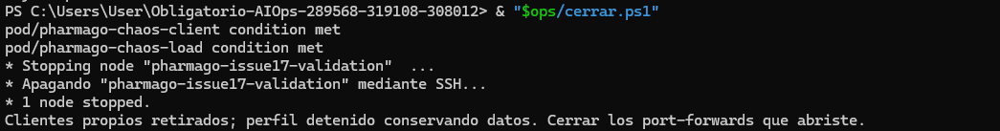

# Seis ensayos guiados y revisión humana — 13/11/2026

**Resultado: seis ensayos ejecutados por Joaquin Decia, seis PASS, seis limpiezas verified.** El operador ejecutó comandos en PowerShell, observó Grafana, comprobó pods y endpoints, aportó capturas y escribió la bitácora. Codex preparó helpers locales, guió los pasos y recopiló esta evidencia. La inyección, las sondas y la reversión fueron automatizadas por el controlador; no se presentan como reparaciones manuales.

Complementa la preparación de [OPS-01 / #16](../issue-16-20261112/README.md) y las [pruebas técnicas anteriores de #17](../issue-17-20261112/fix-after-review/README.md), que conservan sus fechas y resultados originales. No se ejecutaron nuevas fallas para empaquetar estos archivos.

## Entorno y trazabilidad

- Contexto `pharmago-issue17-validation`, namespace `pharmago`, Minikube con Docker y Calico, un nodo en una PC Windows. Esto no demuestra separación en nodos físicos distintos.
- Controlador en `90ae6745066a107d2bc8dc014ef2b5dda1064008`, árbol limpio al iniciar los ensayos; hashes de `chaos.py`, `fault.sh` y `probe.py` en cada resumen y reporte. Imágenes de aplicación `chaos-fix-20261112-01`; digests observados en los reportes originales. No se afirma que todas las imágenes se recompilaran desde el commit del controlador.
- Cada ensayo tiene run ID propio, baseline, muestras funcionales, observaciones de telemetría, comparación de recursos, ventana estable de al menos 120 s y journal terminado. Los reportes comprueban contenido esperado mediante `valid` y fingerprints, además del HTTP. Las capturas finales aportan comprobación humana de pods Ready y HTTP 200 para catálogo y roles.
- Los reportes originales íntegros están comprimidos en `report.json.gz`, junto a su journal y un `resumen.json` legible. [Procedencia y hashes originales](procedencia.json), [resumen general](resumen.json), [manifiesto del paquete](manifest.json) y [verificación](validacion.json).

## Resultados

| Orden | Ensayo y evidencia | Estímulo y efecto observado | Recuperación |
|---|---|---|---|
| 1 | [CPU](ensayos/cpu/README.md) | Carga durante 130 s; máximo muestreado cercano a 0,501 cores en Pharmacy; alerta CPU pasó por Pending/Firing | Retirada automática, curva desciende, cinco reglas sanas/inactivas, pods Ready y HTTP 200 |
| 2 | [Solicitudes](ensayos/requests/README.md) | 240 solicitudes en 60 s: 100 HTTP 200 y 140 HTTP 429; aumento de tráfico y rechazos en Grafana | 429 vuelve a cero; sin 5xx en el panel; sondas legítimas válidas y comprobaciones finales aprobadas |
| 3 | [RAM](ensayos/ram/README.md) | Retención de 32 MiB durante 60 s; working set sube de unos 84 a 118 MiB | Liberación automática y regreso próximo al baseline; comprobaciones finales aprobadas |
| 4 | [Almacenamiento](ensayos/storage/README.md) | Archivo temporal de 32 MiB fuera de PVC; aumento visible del filesystem del pod | Archivo retirado y gráfica vuelve al baseline; datos y recursos comparados sin cambios |
| 5 | [Red](ensayos/network/README.md) | NetworkPolicy ingress: Pharmacy con conexión nueva pasa de HTTP 200 a timeout; roles por Gateway sigue en 200 | Política retirada, Pharmacy vuelve a 200; ventana estable y comprobaciones finales aprobadas |
| 6 | [Desconexión interna](ensayos/disconnect/README.md) | Selector temporal del Service: Pharmacy con conexión nueva da conexión rechazada; roles por Gateway sigue en 200 | Selector original restaurado, Pharmacy vuelve a 200; ventana estable y comprobaciones finales aprobadas |

Las cinco reglas terminaron sanas/inactivas en todos los ensayos. CPU sí registró Firing; las pruebas acotadas de RAM/disco/red no implican disparo de sus alertas. La prueba específica de cinco alertas se conserva en [#13](../issue-13-20261112/README.md). Los paneles de latencia media no se usan como prueba de p95.

Una [corrida adicional de solicitudes ejecutada por el agente](ejecucion-asistida/README.md) se guarda aparte por trazabilidad. No se cuenta entre los seis ensayos del operador.

## Aplicación del proceso de incidentes

Joaquin asumió operación, coordinación y registro en la nota inicial de las 15:02:21 UTC. El intercambio de instrucciones y capturas ocurrió en el chat con Codex; la [bitácora local](bitacora.md) es el registro exportado. No se enviaron mensajes a terceros ni se representa el chat como una comunicación al equipo o al docente. No se registraron suplentes, severidad formal por ensayo o escalamiento real.

El operador revisó planes sin mutaciones, lanzó un caso a la vez, observó el efecto, comprobó restauración y anotó la revisión. Las fichas enlazadas arriba documentan los seis mecanismos y sus límites. Los helpers locales no se incorporan como código operativo al repositorio: los comandos equivalentes usan el controlador ya versionado.

Los reportes conservan `tAck: null`. La nota explícita de reconocimiento de CPU se registró a las **15:09:22 UTC**, después del fin técnico de CPU a las 15:08:49 UTC. La revisión de RAM se anotó retrospectivamente a las **18:21:49 UTC**; no se retrodata. Las demás notas de cierre mantienen sus horas reales. No se calculan TTA, TTD humano o promedios a partir de la mera ejecución del script. `injectionRequestedUtc` es la solicitud de inyección; `faultRestoredUtc` la reversión confirmada; `tRestore` el inicio observado de estabilidad y `tVerified` el fin de la ventana muestreada. Ninguno equivale a una reparación causal de un defecto de aplicación.

Para red y desconexión hay [siete consultas manuales originales](conectividad.jsonl), con conexiones nuevas y `Connection: close`. Una consulta de desconexión posterior a la reversión se etiquetó accidentalmente `durante`; se conserva intacta. Para comprobar recuperación se utiliza la consulta posterior explícita `despues` de las 18:13:23 UTC. La interpretación se hace con las horas observadas y no solo con el rótulo declarado.

La revisión humana en solitario queda documentada. **No se afirma revisión independiente por un compañero**, que sigue siendo un criterio interno abierto de #16; el enunciado exige un plan de incidentes, pero no prescribe que otro integrante ejecute estos runbooks. Esta evidencia no cierra automáticamente #16 ni los pendientes académicos de alcance físico, SQL, dataset o defensa.

## Revisión posterior y mejoras de instrucciones

| Dificultad observada durante la guía | Aclaración incorporada a los runbooks |
|---|---|
| Variables disponibles en una terminal pero ausentes en otra | Inicializar contexto y rutas por sesión; usar ruta absoluta en la segunda terminal |
| Pods aún no Ready inmediatamente después de iniciar Minikube | Esperar el baseline sano antes de inyectar; Running aislado no alcanza |
| Ingreso de la clave literal `grafanaAdminPassword` en el login | Usar el valor privado local; nunca publicar capturas de la contraseña |
| Leyendas extensas ocultan el pod objetivo en Grafana | Identificar el pod por journal/UID y aislar su serie; mantener antes, subida y bajada |
| Duda sobre paneles necesarios para solicitudes | Registrar tráfico, 429, 5xx, latencia y scrape; distinguir tasa de conteo total y media de p95 |
| Rótulo `durante` usado después de la reversión | Conservar el registro original y añadir la consulta correcta `despues` |
| Nota RAM no registrada al terminar | Añadir revisión retrospectiva con hora actual, sin repetir la falla ni inventar reconocimiento |

Las aclaraciones están en [los runbooks](../../runbooks/incidentes.md#aprendizajes-de-la-ejecución-guiada-del-13112026). La revisión guiada encontró estas dificultades; no equivale a una prueba de que un tercero pueda seguirlos sin ayuda.

## Cierre del laboratorio

Después de confirmar todos los pods Ready y catálogo/roles HTTP 200, el operador ejecutó el helper local `cerrar.ps1`. Comprobó ausencia del lock de caos, retiró únicamente los dos clientes registrados por UID y detuvo `pharmago-issue17-validation`. La [captura de cierre](capturas/cierre-laboratorio-20261113.png) confirma la parada conservando datos. No se borraron los volúmenes. No se registró un timestamp exacto del apagado y no se infiere de la hora de copia de la imagen. El cierre de ventanas de port-forward se indicó al operador; no hay evidencia de su ejecución.



Las dos últimas notas también se conservan en [captura](capturas/cierre-anotaciones-disconnect-ram-20261113.png). Las **37 capturas originales** están en [el índice con SHA-256](capturas/indice.json). Los nombres y horas de recopilación no sustituyen las horas del controlador o de la bitácora.

## Reproducir

Para futuras ejecuciones, preparar primero el laboratorio, clientes, credenciales por entorno y los prechecks de la [guía de caos](../../../Implementacion%20K8S/Codigo/chaos-engineering/README.md) y el [plan](../../baseline-incidents.md). El laboratorio de esta evidencia quedó detenido; estos comandos no deben ejecutarse sobre otro entorno por copiar el nombre.

En cada sesión PowerShell definir las variables necesarias:

```powershell
$ctx = 'pharmago-issue17-validation'
$codigo = Join-Path (Get-Location) 'Implementacion K8S/Codigo'
$chaos = Join-Path $codigo 'chaos-engineering'
# Primero plan offline, sin --execute:
python "$chaos/chaos.py" ram --context $ctx --operator 'Joaquin Decia' --duration 60 --megabytes 32
```

Los comandos equivalentes reales se muestran en cada ficha; `--execute` inyecta la falla. Las contraseñas se suministraron en memoria, sin imprimirlas ni guardarlas aquí. No se publica el archivo privado, el seed ni un dump de Secrets.

Para leer un reporte original sin iniciar infraestructura, desde la raíz del repositorio:

```powershell
python -c "import gzip,json,pathlib; p=pathlib.Path('docs/evidence/issue-16-20261113/ensayos/ram/report.json.gz'); d=json.loads(gzip.decompress(p.read_bytes())); print(d['runId'],d['status'],d['cleanup'])"
```

La incorporación es exclusivamente documental: fichas, capturas, evidencia original, matriz y aclaraciones de runbooks. Las comprobaciones del paquete son offline y no reinyectan fallas.

Para comprobar los hashes de todos los archivos del paquete desde la raíz, sin acceder al clúster:

```powershell
@'
import hashlib, json
from pathlib import Path
p = Path('docs/evidence/issue-16-20261113')
m = json.loads((p / 'manifest.json').read_text(encoding='utf-8'))
for item in m['files']:
    data = (p / item['file']).read_bytes()
    assert len(data) == item['bytes']
    assert hashlib.sha256(data).hexdigest() == item['sha256'], item['file']
print('PASS:', len(m['files']), 'archivos verificados')
'@ | python -
```
