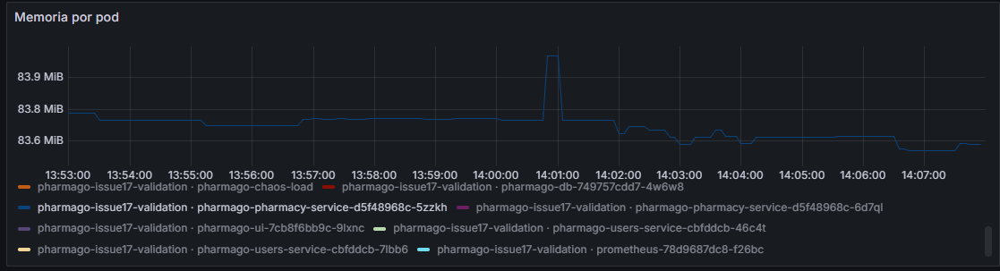
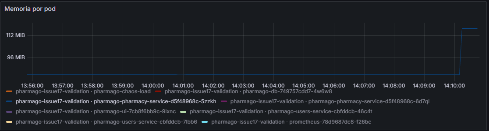
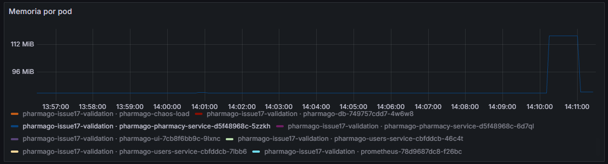
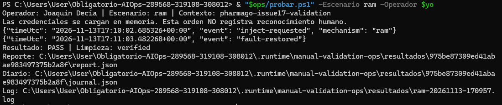
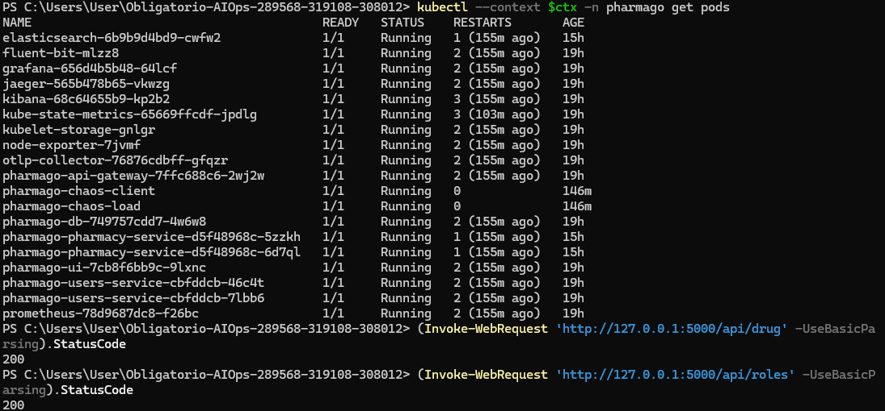

# Ensayo RAM — ejecución del operador

13/11/2026. Run ID `975be87309ed41abae983497375b2a8f`. **PASS / limpieza verified**. Retención de 32 MiB durante 60 s; liberación automática sin usar disco como sustituto.

## Ejecución y alcance

Joaquin Decia ejecutó el helper local `probar.ps1 -Escenario ram -Operador $yo`, después de revisar el plan con `-SoloPlan`. El helper invocó el controlador versionado, cargó credenciales solo en memoria y conservó el reporte. Comando equivalente, con variables y credenciales preparadas según la [guía principal](../../README.md#reproducir):

```powershell
python "$chaos/chaos.py" ram --context $ctx --operator "Joaquin Decia" --duration 60 --megabytes 32 --execute
```

Controlador en commit `90ae6745066a107d2bc8dc014ef2b5dda1064008`, árbol limpio al iniciar. Laboratorio Minikube local de un nodo con Calico; no demuestra nodos físicos distintos. Codex guió los pasos y recopiló los archivos; el controlador automatizó la inyección, las sondas y la reversión.

## Resultado observado

Working set máximo muestreado durante la inyección: 117.73 MiB; baseline máximo: 83.89 MiB. La captura muestra subida de unos 32 MiB y liberación. La nota humana de cierre se añadió retrospectivamente a las 18:21:49 UTC, con su hora real.

Ventana de verificación estable registrada: **122.361 s**, desde `tRestore` hasta `tVerified`; muestreo finito, no garantía continua fuera de esa ventana. PV, PVC y deployments coinciden antes/después. Las cinco reglas terminaron con salud `ok` y estado `inactive`. No se modificaron umbrales para esta prueba.

| Evento del controlador | UTC |
|---|---|
| startedUtc | `2026-11-13T17:09:57.637047+00:00` |
| injectionRequestedUtc | `2026-11-13T17:10:02.685326+00:00` |
| faultRestoredUtc | `2026-11-13T17:11:03.482251+00:00` |
| tRestore | `2026-11-13T17:11:05.982824+00:00` |
| tVerified | `2026-11-13T17:13:08.343750+00:00` |
| finishedUtc | `2026-11-13T17:13:11.117941+00:00` |

`tAck` del reporte permanece `null`. Las [notas del operador](../../bitacora.md) tienen su propia hora; no se reemplazan por el inicio del script ni se calculan TTA o promedios sin observaciones suficientes.

[Resumen y métricas](resumen.json) · [Reporte original completo comprimido](report.json.gz) · [Journal original](journal.json) · [Conectividad manual](../../conectividad.jsonl).

## Capturas proporcionadas por el operador










